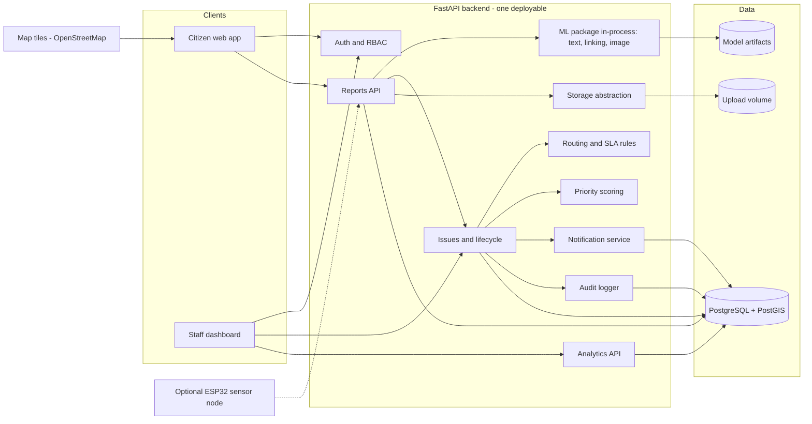

# Urban Infrastructure Intelligence for Bengaluru — Plan v1 (for review)

Provisional plan, written 28 Oct 2026. Phase-II date and rubric are unknown (questions at the end). Nothing is implemented yet, as you asked. Your Phase-I PPT was not attached, so I worked from your summary of it; send it if you want slide-level reconciliation.

## 0. Executive assessment

**Verdict.** Good problem, strong local motivation, but the concept as written is about twice what four students can build and defend in 12 weeks. The fix is not cutting AI. It is picking one spine and hanging everything else off it.

**The spine (recommended version).** An *issue-centric* civic platform. Citizen reports are treated as **observations**. The system links them to one tracked **issue** (a pothole, a dumping spot, an open trench), places it in a zone, routes it to a configurable department, scores priority with a visible formula, and keeps an auditable lifecycle: acknowledge → work → resolve → citizen verifies → reopen if it fails or recurs. Recurrence hotspots and SLA metrics then fall out of the data model almost for free.

**Why this is not just another complaint site.** Tools already exist: BBMP-era Sahaaya 2.0 / Namma Bengaluru and the Fix Pothole app (Raste Gundi Gamana). Press and citizen reports (Deccan Herald, Citizen Matters) describe complaints marked closed without work, a 'long-term solution' status, and no way for the citizen to reopen or escalate. Those reports are BBMP-era and I did not verify the current GBA-era apps, so phrase this in your defence as 'reported gaps', not as proven facts. The gap worth targeting is not reporting. It is **linking and lifecycle integrity**: one real-world problem, one record, verified closure, visible recurrence.

**Proposed title.** *Issue-Centric Urban Infrastructure Intelligence for Bengaluru: Report Linking, Explainable Prioritisation and Accountability Analytics.* The current title overclaims 'AI-Powered' for the whole system and 'Accountability System' implies enforcement. The new one states the actual engineering contribution.

**Differentiators, ranked by defensibility**

| # | Differentiator | Honest status | Decision |
| --- | --- | --- | --- |
| 1 | Report-vs-issue model with spatial + semantic linking | Known techniques, new integration for this setting | Core (P0) |
| 2 | Auditable lifecycle: evidence, citizen verification, reopen, recurrence link | Targets a reported gap | Core (P0) |
| 3 | Explainable priority score with visible breakdown | Transparent formula, not ML | Core (P0) |
| 4 | Fair, uncertainty-aware performance metrics | Analytics method | P1 |
| 5 | Public works + proximity notifications | Curated or simulated data only | P1 |
| 6 | Sensor observations feeding the same issue model | One optional node | P2 |

Nothing here is research novelty. It is a coherent engineering integration with clear evaluation. Say exactly that in the defence; it is credible, and overclaiming is the fastest way to lose marks.

**Verified facts vs assumptions**

| Item | Status | Implication |
| --- | --- | --- |
| BBMP was replaced by the Greater Bengaluru Authority (GBA) under the Greater Bengaluru Governance Act, 2024, with five city corporations | Verified via news and Wikipedia (secondary sources) | Any BBMP-era department or ward mapping you find online is outdated |
| 369 wards: Central 63, North 72, East 50, South 72, West 112 | Verified via South First / Deccan Herald reporting on the Nov 2025 notification | Re-check against the official notification before quoting in the report |
| Corporation elections still pending (court deadline reportedly 31 Dec 2026) | Reported, may change | Do not model elected councillors at all |
| Open311 is an existing standard for civic service requests | Mentioned in Citizen Matters | Loosely align API field names with it; cheap interoperability argument |
| RDD2022: 47,420 road images, 6 countries incl. India (about 9,665 India images), 4 damage types incl. potholes | Verified via the dataset paper and Dataset Ninja | Licence not confirmed by me; check the official source before use |
| Which department owns which issue category under GBA | NOT verified | Use a labelled DEMO configuration |
| Whether GBA/Sahaaya/any official API is accessible to you | NOT verified, assumed no | Nothing depends on it |
| Phase-II date, rubric, your exam schedule | Unknown | Provisional dates below |

**Pushback — what I changed from your prompt**

- **Voice reporting: cut.** Costs a speech pipeline and Kannada/English handling for a feature the evaluators will not reward over a working core.
- **Predictive hotspots: replaced** with descriptive hotspot detection. You will not have real history; forecasting on synthetic data is circular.
- **Image detection is not the core.** The app must work with the image model switched off. It enters as a proof of concept, then an advisory severity signal.
- **No public league table of zones or officials.** Publish metrics with sample sizes and intervals, no single composite score, no individual names.
- **'Competition' reframed as transparency.** The first is hard to defend; the second is.
- **One study area with 2–3 zones, not Bengaluru.** Depth beats coverage.
- **Do not start duplicate detection before the basic flow works.** It is the most interesting part and the easiest place to burn weeks.

## Deliverable 1 — Critical project assessment

**Real problem.** A citizen cannot tell who owns a problem, whether anyone acted, or whether their report is the tenth about the same pothole. Authorities get a flat stream of tickets with no spatial grouping, no deduplication, and no view of what keeps breaking.

**Users.** Citizen; department officer; zone head (and department head); administrator. A public read-only viewer is optional (P1).

**Too broad?** Yes. Seven sections (A–G), seven problem statements and eight original objectives overlap heavily:

- 'Authority mapping', 'responsibility mapping' and 'issue routing' are one module.
- 'Hotspots', 'recurring issues' and 'accountability insights' are one analytics module.
- 'Performance benchmarking' and 'standardised accountability metrics' are one metrics module.
- 'Multimodal reporting' is a report form plus optional voice (cut).

**Technically hard (plan time for these):**

1. Linking correctness. A false merge hides a real separate pothole; a missed merge just creates a duplicate. Favour precision.
2. Responsibility data. The mapping is organisational knowledge you do not have verified. Build the engine, not the facts.
3. Domain shift. Public road-damage images are not Bengaluru roads.
4. Fair metrics. Easy to compute, hard to make non-misleading.

**What makes a strong 200-mark project:** a system that runs end-to-end from a clean checkout; two or three AI/ML components each with a baseline, a held-out test set and an honest limitations section; a clean relational and geospatial data model; real tests; and a team that can explain every module.

**Reconciliation with the Phase-I PPT (from your summary)**

| Original item | Decision |
| --- | --- |
| Multimodal reporting | Keep: photo + text + map pin. Voice deferred indefinitely |
| AI classification | Keep: text classifier (P0); image model as PoC then P1 |
| Authority mapping | Keep as a configurable rules engine over demo data |
| End-to-end tracking | Keep, strengthened into the lifecycle with verification and reopen |
| Hotspot identification | Keep as descriptive clustering |
| Accountability insights + performance benchmarking | Merge into one metrics module; P1; reframe as transparency |
| Duplicate detection | Keep; central to the differentiator; P0 but after the Phase-II slice |
| Outcomes: faster routing, reduced duplication | Do not claim real-world improvement. Measure only on seeded/simulated workloads and say so |
| Problems: 'resource constraints', 'difficulty scaling manual processes' | Remove; you cannot demonstrate either in a semester |

## Deliverable 2 — Final scope and feature priorities

Tiers are time-ordered. **P0-A** must exist at the Phase-II checkpoint. **P0-B** is still essential but lands after it.

| Feature | Tier | Why |
| --- | --- | --- |
| Register / login, citizen + staff roles (JWT) | P0-A | Everything else needs identity and RBAC |
| Report submission: photo, description, category, map location | P0-A | The data source for the whole system |
| Zone lookup of a report (PostGIS point-in-polygon) | P0-A | Cheap, impressive, proves the geo layer is real |
| Map + list of reports; seeded demo data labelled DEMO | P0-A | Visible progress |
| Text category suggestion (baseline model) | P0-A | One AI capability started, as the checkpoint asks |
| Architecture + ERD documents | P0-A | Phase-II requirement |
| Issue entity + duplicate linking | P0-B | The core differentiator |
| Lifecycle state machine, status history, SLA timestamps | P0-B | Auditability is the second differentiator |
| Responsibility rules engine (configurable) | P0-B | Required by your own spec; no hardcoding |
| Priority score with breakdown | P0-B | Transparent, cheap, demo-friendly |
| Officer dashboard: queue, acknowledge, resolve with evidence | P0-B | Closes the loop |
| Citizen tracking, feedback, reopen, in-app notifications | P0-B | Closes the loop for the citizen |
| Audit log, upload hardening, RBAC tests | P0-B | Your rule 8; also easy marks |
| Image road-damage model integrated as advisory severity | P1 | Valuable, but riskiest ML; PoC before this |
| Recurrence links + hotspot clustering | P1 | Needs the issue model first |
| Zone/department metrics with fair comparison | P1 | Needs lifecycle data |
| Public works module (admin-managed) + in-app proximity notices | P1 | Differentiator 5 with curated data |
| Admin console for zones, rules, SLA, users | P1 | Seed scripts cover P0 |
| Email notifications | P1 | In-app is enough for P0 |
| ESP32 water-level node | P2 | Only if everything else is stable |
| Phone road-survey mode (batch geotagged frames) | P2 | Reuses the detector |
| Kannada text support beyond what multilingual embeddings give free | P2 | Needs data you do not have |
| Empirical-Bayes shrinkage for small-n metrics | P2 | Nice statistics, not required |
| **Out of scope:** voice reporting, live traffic, any government integration or real official data, predictive failure forecasting, individual officer ranking, push notifications, native mobile app, multi-city, payments | Out | Unverifiable, unbuildable, or ethically shaky |

## Deliverable 3 — End-to-end workflows

| # | Workflow | What happens | What the user sees |
| --- | --- | --- | --- |
| 1 | Citizen reports | Signs in, taps Report, adds a photo (jpg/png/webp, size-limited), types a description, drops a pin or uses GPS, confirms category | Form with map pin and detected zone name; a chip like 'Suggested: Pothole (87%)' that they can override; a reference ID on success |
| 2 | Classify and locate | Backend validates the file (magic bytes, size, re-encode, strip EXIF), stores it, finds the zone with ST\_Contains, runs the text model, stores both the user's category and the prediction. Outside the pilot area it is rejected with a clear message | 'Received. Zone: Demo Zone A.' |
| 3 | Link or create issue | Searches open and recently resolved issues of compatible category within a category-specific radius and time window, scores candidates. High score: attach report to that issue. Medium: create a new issue flagged 'possible duplicate' for officer review. Low: new issue. Linking is reversible and audited | Citizen: 'Similar issue already reported nearby (3 reports). Yours was added.' Officer: linked reports and a link-confidence explanation |
| 4 | Route and prioritise | Rules engine maps (category, zone) to a department; SLA policy sets due times; priority score computed and stored with its component breakdown. No matching rule sends the issue to a triage queue instead of guessing | Officer queue sorted by priority, hover shows why |
| 5 | Officer acts | Filters the queue by department and zone, opens an issue (map, photos, linked reports, history), then Acknowledge, Reject/Reroute (reason mandatory), Start work, or Resolve (evidence photo and note mandatory) | Status chips, SLA countdown, audit-backed history |
| 6 | Citizen follows up | Gets in-app notifications on each transition. On 'resolved', asks 'Is it actually fixed?'. 'Fixed' plus a rating closes it as verified; 'Not fixed' reopens it. No response in 7 days closes it as **unverified**, which is a separate state used in metrics | My Reports timeline, notification bell, a Confirm / Reopen prompt |
| 7 | Head monitors | Opens a scoped dashboard: backlog by category and age, median acknowledgement and resolution times, SLA compliance with sample size and interval, reopen rate, recurrence map, hotspot list. CSV export | Charts, a map, and 'insufficient data' labels where n is small |
| 8 | Admin manages | CRUD for zones (GeoJSON upload), departments, responsibility rules (each with source and a verified/demo flag), SLA policies, users and roles, public works. Audit log viewer | Admin console with a persistent DEMO CONFIGURATION banner while data is unverified |

## Deliverable 4 — System architecture



Paste the block into mermaid.live if the doc viewer does not render it.

**Data flow.** (1) The browser calls REST/JSON endpoints; the OpenAPI schema FastAPI generates is the contract. (2) A report upload is validated, stored, geolocated in PostGIS, and classified. (3) The linking module queries PostGIS for spatial candidates first, then scores them with text and image similarity. (4) The issue service applies routing rules, SLA policy and the priority formula, and writes status history and audit rows in the same transaction. (5) Notifications are rows in a table the client polls (no push infrastructure). (6) Analytics are SQL aggregates over issues, history and feedback. (7) The optional ESP32 posts readings to a sensor endpoint that creates observations on the same issue model.

**Deliberately absent:** microservices, message queues, Redis, Kubernetes, paid APIs. ML runs in-process; slow work runs in FastAPI background tasks. If a job fails, the report is still saved.

**What is what**

| Capability | Type |
| --- | --- |
| Registration, RBAC, CRUD, uploads, status transitions, notifications | Ordinary application logic |
| Point-in-polygon zone lookup, radius search | Geospatial query (PostGIS), not AI |
| Responsibility mapping, SLA due dates, state machine | Rules-based, data-driven configuration |
| Priority score | Transparent weighted formula, not ML |
| Dashboard 'insight' sentences | Templated text from computed statistics, not AI. Label it that way |
| Hotspot detection | Classical unsupervised algorithm (DBSCAN), descriptive |
| Text category suggestion | **ML** (embeddings + classifier), with a keyword/TF-IDF baseline |
| Duplicate/linking score | **ML-assisted**: similarity features (embeddings, perceptual hash) combined by a small trained model, or hand weights as baseline |
| Road-damage detection | **ML** (fine-tuned pretrained vision model), advisory only |

## Deliverable 5 — Database design

PostgreSQL 16 + PostGIS. UUID primary keys, `created_at` / `updated_at` everywhere, soft delete only where noted. Points are stored as `geography(Point,4326)` so `ST_DWithin` takes metres directly. Zone polygons are `geometry(MultiPolygon,4326)`. All spatial columns get GiST indexes.

| Table | Key columns | Notes |
| --- | --- | --- |
| `users` | id, email (unique), password\_hash (argon2), full\_name, role enum (citizen, officer, zone\_head, dept\_head, admin), is\_active | Staff never see a citizen's email or phone; they see a pseudonymous reporter id |
| `user_scopes` | user\_id, department\_id, zone\_id | Staff visibility = their (department, zone) pairs. Admin sees all |
| `zones` | id, name, level enum (corporation, ward, demo\_zone), parent\_id, geom, is\_demo, source\_note, source\_verified | Self-referencing hierarchy. Demo zones carry is\_demo = true and a visible banner |
| `departments` | id, code, name, is\_demo | Sample departments only unless you verify real ones |
| `categories` | id, code, name, parent\_id, default\_radius\_m, default\_dedupe\_window\_days | Radius and window drive linking |
| `responsibility_rules` | id, category\_id, zone\_id (nullable = all zones), department\_id, rank, valid\_from, valid\_to, source\_note, verified | Most specific rule wins (zone-specific over general, then lowest rank). No match = triage queue |
| `reports` | id, reporter\_id, issue\_id (FK, nullable until linked), description, category\_user\_id, category\_pred\_id, pred\_confidence, location, zone\_id, link\_score, link\_method, status enum (received, linked, rejected), is\_synthetic, created\_at | One row per citizen observation. Never deleted by officers |
| `issues` | id, category\_id, location (centroid or representative point), zone\_id, department\_id, status enum, severity\_score, severity\_source enum (user, text, image, officer), priority\_score, priority\_breakdown (jsonb), sla\_policy\_id, ack\_due\_at, resolve\_due\_at, first\_reported\_at, acknowledged\_at, resolved\_at, verified\_at, closed\_at, reopen\_count, recurrence\_of\_issue\_id (self FK), report\_count, is\_synthetic | The tracked real-world problem. Owns lifecycle |
| `attachments` | id, owner\_type (report, resolution), owner\_id, storage\_key, mime, sha256, width, height, phash, created\_at, deleted\_at | Files live on disk or object storage; DB stores metadata only. phash supports image dedupe |
| `report_embeddings` | report\_id, text\_emb real\[\], image\_emb real\[\] (nullable), model\_version | Plain arrays; candidate sets are tiny after the spatial filter, so no pgvector dependency |
| `issue_status_history` | id, issue\_id, from\_status, to\_status, actor\_id, reason, created\_at | Append-only. Source of truth for all timing metrics |
| `assignments` | id, issue\_id, department\_id, assignee\_user\_id (nullable), assigned\_by, is\_active, created\_at | Reroutes create a new row; old one goes inactive |
| `sla_policies` | id, category\_id, severity\_band, ack\_hours, resolve\_hours, is\_demo | Policy chosen at issue creation, stored on the issue so later edits do not rewrite history |
| `feedback` | id, issue\_id, reporter\_id, verdict enum (fixed, not\_fixed), rating (1–5, nullable), comment, created\_at | Feeds verified-resolution and reopen metrics |
| `public_works` | id, title, department\_id, zone\_id, geom (polygon or line), start\_date, end\_date, status, progress\_pct, last\_update\_at, disruption\_note, is\_synthetic | Admin-managed (P1) |
| `work_updates` | id, work\_id, note, created\_by, created\_at | P1 |
| `notifications` | id, user\_id, type, payload (jsonb), read\_at, created\_at | Client polls; no push infra |
| `audit_logs` | id, actor\_id, action, entity\_type, entity\_id, before (jsonb), after (jsonb), ip, created\_at | Append-only; written in the same transaction as the change |
| `ml_predictions` | id, model\_name, model\_version, input\_ref, output (jsonb), created\_at | Lets you answer 'which model said that?' during a viva |
| `sensor_observations` | id, device\_id, issue\_id (nullable), reading, location, observed\_at | P2 only; do not create the table until then |

**Issue status enum:** `new`, `acknowledged`, `in_progress`, `resolved_pending_verification`, `closed_verified`, `closed_unverified`, `rejected`, `reopened`.

Allowed transitions (enforced in one service function, tested exhaustively):

- new → acknowledged, rejected
- acknowledged → in\_progress, rejected
- in\_progress → resolved\_pending\_verification
- resolved\_pending\_verification → closed\_verified (citizen says fixed), reopened (citizen says not fixed), closed\_unverified (7 days, no response)
- closed\_unverified → reopened (a later report links to it, or a citizen disputes it)
- reopened → acknowledged, in\_progress
- Rerouting changes the assignment, not the status.

**Recurrence rule.** A new report that matches a *closed* issue (same category, within 50 m, within 180 days; tunable) either reopens it (if closed within a short window) or creates a new issue with `recurrence_of_issue_id` set. Pick one rule and document it; I recommend: within 14 days reopen, otherwise recurrence link.

**Important indexes**

- GiST: `reports.location`, `issues.location`, `zones.geom`, `public_works.geom`
- `issues(department_id, status)`, `issues(zone_id, category_id, first_reported_at)`
- Partial index on `issues(...)` where status is in an open state
- `reports(issue_id)`, `issue_status_history(issue_id, created_at)`, `notifications(user_id, read_at)`
- Unique `users(email)`; unique `attachments(sha256, owner_id)` to stop accidental double-upload

**Geographic considerations.** GPS from a phone in a dense street is often 10–30 m off, so radii below 30 m produce missed matches. Zone lookup uses the reported point, so reports near a boundary can land in the wrong zone; show the detected zone to the user and let officers reroute. Strip EXIF GPS from stored images after reading it; keep the location in the database only.

**Privacy and retention.** Reporter identity is pseudonymous to staff. Photos are re-encoded and EXIF-stripped. Define a retention rule (for example, delete attachments and anonymise reports 12 months after closure) and implement it as a script even if the demo never runs it. Staff access to attachments goes through authorised endpoints, never public file URLs.

## Deliverable 6 — AI/ML plan

MVP gets **two substantial ML components** (text classification, duplicate/linking) plus **one proof-of-concept** (image road-damage detection) that stays advisory. Everything else is rules or classical algorithms and is labelled that way.

### AI-1: Text category suggestion (P0, started before Phase II)

| Aspect | Plan |
| --- | --- |
| Problem | Suggest a category from a free-text description so citizens and routing start with the right label |
| Input / output | Description string → category among about 7 classes (pothole/road damage, footpath, garbage/dumping, drainage/water, streetlight, excavation/works, other) with a calibrated confidence |
| Baseline | Keyword rules, then TF-IDF + logistic regression |
| Model | Multilingual sentence embeddings (a MiniLM-class sentence-transformers model; confirm availability and licence when you pick one) with a logistic-regression head. Embeddings also feed linking, so the cost is paid once |
| Data | No verified public Bengaluru complaint corpus that I could confirm. Build one (see Deliverable 7): hand-written, synthetic, and independently written test set |
| Training | Stratified split; cross-validation on train; **test set written by different people and never touched until the end** |
| Metrics | Macro-F1, per-class precision/recall, confusion matrix, reliability curve. Report baseline vs model |
| Failure cases | Mixed-category texts, very short text, Kannada script, sarcasm, 'near' vs 'on' the road. Mitigation: below a confidence threshold the user must choose; the user's own choice always wins and both are stored |
| Limitation to state | Trained largely on synthetic and team-written text, so measured accuracy is optimistic for real citizen language |

### AI-2: Duplicate and linking (P0-B)

| Aspect | Plan |
| --- | --- |
| Problem | Decide whether a new report observes an existing issue |
| Pipeline | (1) PostGIS candidate filter: same or compatible category, within radius and time window. (2) Features per candidate: distance (m), time gap, category match, text-embedding cosine, image similarity (perceptual hash distance as baseline; image-embedding cosine if time allows). (3) Score |
| Scoring | Baseline: hand-set weights. Model: logistic regression or small gradient-boosted model trained on labelled report pairs |
| Decision | Three bands: auto-link above a high threshold tuned for **precision at or above 0.95**; officer-review band; new issue below. Unlink is a first-class audited action |
| Data | Pairs from your synthetic generator (ground-truth cluster ids planted) plus 150–200 hand-labelled pairs from real photos you take of the same and different spots |
| Metrics | Pairwise precision/recall/F1 per band, precision at the auto-link threshold, cluster purity, and an ablation (distance only vs + text vs + image) |
| Failure cases | Two adjacent distinct potholes (false merge), same pothole photographed from opposite sides (missed), GPS drift, long linear defects such as an open trench, generic text ('big pothole') |
| Limitation to state | Synthetic pairs are easier than real ones; report the real-photo pairs separately |

### AI-3: Road-damage detection (PoC, P1 integration)

| Aspect | Plan |
| --- | --- |
| Problem | Confirm a road defect is visible and estimate how large it looks |
| Input / output | Photo → boxes with class (pothole, crack types) and confidence; severity feature = largest-box area ratio |
| Baseline | Image-level 'pothole present?' classifier fine-tuned from a small pretrained network (MobileNet or ResNet class); also a zero-shot CLIP-style check as a second baseline |
| Model | Fine-tune a pretrained detector on the India subset of RDD2022 plus your own photos. Ultralytics YOLO is the easiest route but is AGPL-licensed, so check that it is acceptable for your submission; torchvision detectors are the permissive alternative |
| Training | Transfer learning on a free GPU session; small image size; early stopping |
| Metrics | Precision, recall and mAP@0.5 on held-out RDD data **and separately** on your own Bengaluru photos, so the domain-shift gap is visible |
| Failure cases | Water-filled potholes, shadows, wet roads, speed breakers, manholes, patched surfaces, phone angle |
| Rule | Advisory only. It never rejects a report and never lowers priority below the citizen's own severity |

### What is not ML, even though it will look smart

- **Hotspots:** DBSCAN on report coordinates with a haversine metric. Descriptive, not predictive.
- **Recurrence:** a query over closed issues. **Priority:** formula. **SLA breach risk:** elapsed time over SLA, a rule.
- **Trends:** time-bucketed counts. There is **no forecasting** anywhere, and the report should say so.

### Priority score (transparent, tunable)

`priority = 100 * (0.30*S + 0.20*E + 0.20*C + 0.15*R + 0.15*A)`

- **S** severity (0–1): from the user's severity choice, adjusted by text keywords and the image signal when present; the source is stored.
- **E** exposure (0–1): road class or nearby school/hospital from OpenStreetMap when available; default 0.5 otherwise.
- **C** corroboration (0–1): `min(1, ln(1+n) / ln(1+10))` for n linked reports, so ten reports are enough to saturate.
- **R** recurrence (0–1): prior closed issues within radius and window, saturating at 3.
- **A** age vs SLA (0–1): elapsed time over resolution SLA, capped at 1.

The breakdown is stored in `priority_breakdown` and shown on hover. Weights live in config. You will **validate** it, not claim it is correct: write about 40 scenarios with an expected ordering, have a mentor or two classmates rank them independently, and report pairwise agreement.

## Deliverable 7 — Realistic data strategy

| Source | Purpose | Licence / considerations | Limits | Used for evaluation? |
| --- | --- | --- | --- | --- |
| OpenStreetMap (basemap, road classes, POIs) | Map display, exposure signal | ODbL, attribution required. Public tile servers have a usage policy, so fine for development and a demo, not heavy traffic. Verify current terms | Coverage and tagging vary | No |
| Official ward / corporation boundaries (GBA delimitation) | Real zones | I could not confirm a ready-to-use GIS file. Obtain from the official notification or an open-data source and check its licence | May be unavailable as polygons | Responsibility-mapping accuracy, if used |
| Demo zones (2–3 hand-drawn polygons) | Fallback and default | Your own work; label DEMO everywhere | Not real administrative units | Yes, as ground truth for zone lookup |
| Older 198-ward BBMP data from open-data communities | Reference only | Outdated since the 369-ward GBA delimitation; never present it as current | Wrong structure | No |
| RDD2022 (India subset about 9,665 images) | Pretraining/fine-tuning the road-damage model | Cite the paper; **check the dataset licence at its official source** | Not Bengaluru; capture style differs | Held-out split |
| Your own road photos (200–400) | Bengaluru test set, linking pairs | You own them. Avoid faces and number plates; blur if present | Small, from one area | Yes, the honest test set |
| Text reports | AI-1 | No verified public corpus found. Do not scrape Sahaaya or social media (terms and privacy unclear). Build: \~300 team-written, \~600 synthetic (flag synthetic), and an **independent test set of 150+** written by 15–20 classmates who never see your categories | Synthetic is optimistic | Yes, independent set only |
| Synthetic operational data | Dashboards, lifecycle, metrics | Generated by a seeded script. Plants known hotspots, duplicate clusters with ground-truth ids, and one deliberately slow department, so analytics can be checked against known truth | Not evidence about real Bengaluru | Yes, for correctness not realism |
| Synthetic public works (10–15 projects) | P1 module | Clearly labelled synthetic | Not real projects | No |
| Sensor readings (optional) | P2 | Your own | Bench-test only | No |

**Study area.** Pick 2–3 contiguous areas around your campus or hostel where you can physically photograph defects. Do not claim which corporation they fall under until you check the notification.

**Demonstrating without complete citywide data.** Everything runs on the study area. Every synthetic record carries `is_synthetic = true`, the UI shows a persistent DEMO DATA banner, and the report has a table separating real photos, real-but-team-written text, and synthetic data. Evaluation results are labelled the same way.

## Deliverable 8 — Technology stack and repository

**One consistent stack**

| Layer | Choice | Why |
| --- | --- | --- |
| Frontend | React 18 + TypeScript + Vite, TanStack Query, Tailwind CSS | Common, well covered by AI tools, easy to explain |
| Maps | Leaflet via react-leaflet, OSM tiles with attribution | Simpler than vector-tile stacks; no key needed |
| Charts | Recharts | Adequate for the dashboards |
| Backend | Python 3.11, FastAPI, Pydantic v2 | One language with the ML code |
| ORM / migrations | SQLAlchemy 2, GeoAlchemy2, Alembic | Real migrations, reproducible schema |
| Database | PostgreSQL 16 + PostGIS (official postgis Docker image) | Spatial queries are the core |
| Auth | Own JWT (short-lived access token, refresh in httpOnly cookie), argon2 hashing, role checks as FastAPI dependencies | Keycloak/Auth0 add infrastructure for no marks |
| ML | scikit-learn, sentence-transformers (CPU torch), imagehash, Pillow, a vision library for the detector, pandas, matplotlib | Standard and CPU-friendly except detector training |
| Background work | FastAPI background tasks | Avoids Celery and Redis |
| Storage | Local volume behind a `StorageBackend` interface | Swap to object storage later without code changes |
| Dev and deploy | Docker Compose (db, api, web); demo from a laptop, optional single VM if your college provides one | Cheap and reliable; I have not verified free hosting tiers, so do not plan around one |
| Client contract | OpenAPI → generated TypeScript types | Frontend and backend cannot drift silently |

**Communication.** Browser to API over REST/JSON. The ML package is imported by the service layer inside the API process. Model weights live under `ml/artifacts/` and are fetched by a script, not committed if large.

**Repository structure**

```
civic-intel/
  README.md
  docs/ (architecture.md, erd.md, api.md, ml/, evaluation/, decisions/, AGENT_RULES.md, KNOWN_LIMITATIONS.md)
  docker-compose.yml
  .env.example
  .github/workflows/ci.yml
  backend/
    pyproject.toml
    alembic.ini
    migrations/
    app/
      main.py
      core/ (config.py, security.py, deps.py, logging.py)
      db/ (session.py, models/)
      schemas/
      api/v1/ (auth.py, reports.py, issues.py, zones.py, analytics.py, admin.py, notifications.py)
      services/ (reports.py, issues.py, routing.py, priority.py, sla.py, linking.py, analytics.py, notifications.py, storage.py, audit.py)
      ml/ (text_classifier.py, linking_features.py, image_detector.py, registry.py)
    tests/ (unit/, integration/, fixtures/)
  frontend/
    package.json, vite.config.ts
    src/ (api/, components/, features/ (reports, map, issues, dashboard, admin), routes/, types/)
  ml/
    notebooks/, training/, evaluation/, data/ (README only; no raw data committed), artifacts/ (gitignored)
  seed/
    zones_demo.geojson, departments_demo.json, rules_demo.json, generate_synthetic.py, README.md
  scripts/ (setup.sh, seed.sh, fetch_models.sh)
```

**Configuration variables (in `.env`, never committed; `.env.example` holds placeholders only):** `DATABASE_URL`, `JWT_SECRET`, `ACCESS_TOKEN_MINUTES`, `REFRESH_TOKEN_DAYS`, `UPLOAD_DIR`, `MAX_UPLOAD_MB`, `CORS_ORIGINS`, `ML_MODEL_DIR`, `ENABLE_IMAGE_MODEL`, `STUDY_AREA_NAME`, `SMTP_*` (optional), `VITE_API_BASE_URL`, `VITE_TILE_URL`.

**External services:** OSM tiles only. No paid APIs.

**Setup (target state)**

```
cp .env.example .env        # then set JWT_SECRET locally
docker compose up -d db
cd backend && alembic upgrade head && python -m seed.load
docker compose up api web
```

## Deliverable 9 — Twelve-week roadmap

**Assumptions.** Week 1 starts Mon 2 Nov 2026, week 12 ends Sun 24 Jan 2027. I do not know your Phase-II date or your exam calendar, so the plan builds the Phase-II slice by **end of week 4 (29 Nov)** and keeps it frozen and demonstrable from then on. If your Phase-II is earlier than that, cut map polish and show the ML proof of concept from a notebook. If it is later, the buffer weeks go to the issue model, not to more screens.

**Rule for the whole project:** `main` always runs from a clean `docker compose up` plus seed. Tag the checkpoint `phase2-demo` and keep a branch for it so later work cannot break the demo.

**Team roles** (each person also owns explaining one module in the viva)

- **A — Backend / DB / geo lead:** schema, migrations, auth, report and issue services, PostGIS queries.
- **B — Frontend lead:** React app, map, forms, dashboards.
- **C — ML lead:** text classifier, linking model, image PoC, evaluation notebooks.
- **D — Data / QA / DevOps / docs:** synthetic generator, photo collection and labelling, CI, tests, documentation, demo script.

Cross-review every merge: A reviews B, B reviews C, C reviews D, D reviews A.

**The four buckets you asked for**

| Bucket | Contents |
| --- | --- |
| 1. Must be complete before Phase II | Scope and architecture docs, ERD and migrations, auth, report submission with photo + text + category + map location, zone lookup, backend-DB connection, map and list of reports, labelled seed data for the study area, demo script |
| 2. In progress or PoC by Phase II | Text classifier baseline with a first evaluation table; image detector smoke test in a notebook; issue entity design; synthetic generator with planted duplicates |
| 3. After Phase II, for the final | Issue entity and linking, lifecycle and SLA, responsibility rules, priority score, officer and citizen workflows, notifications, feedback and reopen, analytics and fair metrics, image model integration, public works, hardening, deployment, full evaluation |
| 4. Stretch, only if the core is stable | ESP32 water-level node, phone road-survey mode, Kannada text improvements, shrinkage-based metrics, public transparency page |

**Week-by-week**

| Week | Focus and tasks | Deliverable and definition of done | Testing | Owners |
| --- | --- | --- | --- | --- |
| **1** (2–8 Nov) Foundations | Repo, Docker Compose, schema v0 and first migration, demo zones and departments seeded, auth skeleton, Vite app with routing and login, CI pipeline. C fixes the category taxonomy and starts text collection. D picks the study area and starts photo collection | `docker compose up` gives API, DB and web; login works; CI green; taxonomy doc agreed | Health endpoint test, auth unit tests, migration up/down | A: schema, auth. B: scaffold, login. C: taxonomy, 150 texts. D: CI, study area, photos |
| **2** (9–15 Nov) Vertical slice 1 | `POST /reports` (multipart), upload validation, zone lookup, citizen report form with map picker, My Reports list. Depends on week 1 schema | A citizen can submit a report with photo and see it listed with its zone. DoD: works from fresh seed, bad uploads rejected | API integration tests, oversized and fake-image tests, manual walkthrough | A: API. B: form + map. C: TF-IDF baseline. D: synthetic generator v0, upload tests |
| **3** (16–22 Nov) Map, staff view, classifier v0 | Staff map with clustering and filters, staff list, classification suggestion endpoint and UI chip, 100 seeded reports | All reports visible on a map; suggestion chip works. DoD: baseline macro-F1 computed on a held-out set and saved in `docs/evaluation/` | Classifier unit tests, evaluation script reproducible by one command | A: filters API, RBAC. B: staff map. C: classifier + eval. D: seeding, docs |
| **4** (23–29 Nov) **Phase-II build freeze** | Bug fixes, architecture and ERD docs, demo script, image detector smoke test in a notebook, internal dry run twice, tag `phase2-demo` | Demo runs three times in a row from a clean machine. DoD: slides and a one-page progress statement written (done / in progress / remaining / next milestones) | Fresh-clone rehearsal; checklist | All; D owns the checklist |
| **5** (30 Nov–6 Dec) Phase-II window / buffer | Present or prepare (whichever applies). Keep `main` moving: issue entity, status history, state machine | Phase II demonstrated. DoD: transition tests pass | Exhaustive transition tests | A: issues. B: issue detail page. C: labelled pair set. D: Phase-II feedback log |
| **6** (7–13 Dec) Linking and routing | Linking service v1 (spatial filter, text cosine, phash), responsibility rules engine, officer queue | New reports link to or create issues; routing works from the rules table. DoD: linking evaluated on pairs, precision at auto-link threshold reported | Pair-based evaluation, rules-engine unit tests (zone-specific beats general, no match goes to triage) | A: rules engine. B: queue UI. C: linking. D: pair labelling |
| **7** (14–20 Dec) Priority, SLA, citizen loop | Priority formula with breakdown, SLA policies and due times, officer actions (acknowledge, resolve with evidence), citizen timeline, notifications, feedback and reopen | The full loop runs: report → resolve → citizen verifies or reopens. DoD: 7-day unverified auto-close works (testable by clock injection) | SLA calculation tests with injected time, priority scenario tests | A: priority, SLA. B: officer and citizen UI. C: scenario set for priority. D: E2E script |
| **8** (21–27 Dec) Analytics | Recurrence linking, DBSCAN hotspots, department and zone metrics with sample sizes and intervals, head dashboard | Dashboard values match hand-computed values on a tiny fixture. DoD: metrics page shows n and 'insufficient data' states | Metric tests on fixtures with known answers; planted-hotspot recovery check | A: metric SQL. B: dashboard. C: hotspots. D: fixtures |
| **9** (28 Dec–3 Jan) Image model and public works | Integrate the detector as an advisory severity signal behind a feature flag, evaluate on own photos. Public works admin module and in-app proximity notices | App works with the model off and on. DoD: image results reported separately for RDD and own photos | Model-off integration tests, public-works tests | C: image model. A: works API. B: works UI. D: evaluation tables |
| **10** (4–10 Jan) Hardening | RBAC test matrix, rate limiting, audit coverage, retention script, error handling, performance check on 5k reports, admin console basics | Security checklist signed off. DoD: no endpoint reachable without the right role | Authorisation matrix tests, upload abuse tests | A: security. B: admin UI. C: perf. D: test matrix |
| **11** (11–17 Jan) Evaluation and deployment | Run every evaluation, ablations, confusion matrices; deploy or package the demo; rehearse the final scenario. Optional ESP32 only if all P0 and P1 are done | Final numbers frozen in `docs/evaluation/`. DoD: demo works offline from Compose | Full regression, rehearsal with an outsider | C: results. D: report. A, B: bug bash |
| **12** (18–24 Jan) Freeze and defence | Code freeze at the start of the week; report, slides, backup demo video, viva rehearsal with the Q&A below | Submission-ready. DoD: fresh-clone test passes; known limitations written | Fresh clone on a different laptop | All |

**Checkpoint risks to watch:** week 2 is the real test of the plan. If a citizen cannot submit and see a report by the end of week 2, stop adding anything else until it works.

## Deliverable 10 — Antigravity implementation instructions

I have not verified Antigravity's current feature set. Where I say 'rules file' below, use whatever persistent instruction mechanism it offers; if it has none, paste the rules block at the top of each prompt. Treat stage boundaries as hard: one stage, one working increment, commit, then the next.

### Rules block (save as `docs/AGENT_RULES.md`, and reference it in every stage)

```
You are working on a student project. Follow these rules in every task.
1. Inspect before changing. List the relevant files and read them first. Do not overwrite or rewrite working modules; make the smallest change that meets the requirement.
2. Work incrementally. Do only what the current stage asks. Do not add features, services or dependencies that are not listed. Ask before adding a new dependency and explain why.
3. Keep API contracts stable. If a contract must change, update the OpenAPI schema, the frontend types and the docs in the same change, and say so.
4. Validate all input. Return structured errors with correct HTTP codes. Never trust client-supplied user ids, roles, or file types.
5. Database changes go through Alembic migrations only. Seed data must be reproducible from a script with a fixed random seed.
6. Never commit secrets. Read configuration from environment variables. Only .env.example with placeholders is committed.
7. Write tests for critical logic (state transitions, SLA calculations, permissions, scoring, linking). Run the relevant tests and the build after every stage and paste the real output.
8. Label demo or synthetic data clearly in data and UI. Never present synthetic results as real.
9. Document setup and run commands in README and update docs for anything you add.
10. At the end, report honestly: what is done, what was tested and the results, what is unfinished or fragile, and any assumptions. Record unfinished work in docs/KNOWN_LIMITATIONS.md. Do not claim something works unless you ran it.
```

### Stage 0 — Inspect and establish the project

- **Goal:** know what exists; set up without overwriting anything useful.
- **Prerequisites:** a working directory (create an empty folder and open it if you have none).
- **Prompt:**

```
Read docs/AGENT_RULES.md if it exists; otherwise create it from the rules I provide below. Then inspect the current working directory. Report: all files and folders (2 levels deep), detected languages and frameworks, existing dependency files, git status, and installed tool versions (python, node, docker, git). Do not modify anything yet. Then propose, as a list, the minimal changes needed to create this monorepo layout: backend/ (FastAPI), frontend/ (React+TS+Vite), ml/, seed/, docs/, scripts/. Wait for my approval before creating anything that would overwrite existing files. If the directory is empty, initialise git and create only docs/, README.md and .gitignore (ignore .env, uploads, ml/artifacts, node_modules, __pycache__).
```

- **Acceptance:** report delivered; no existing file changed; git initialised if empty.

### Stage 1 — Scaffold and Compose

- **Goal:** three containers run and talk to each other.
- **Prerequisites:** Stage 0.
- **Files:** `docker-compose.yml`, `.env.example`, `backend/` (pyproject, `app/main.py`, `core/config.py`), `frontend/` (Vite React TS), `.github/workflows/ci.yml`, README.
- **Requirements:** Postgres 16 with PostGIS image; FastAPI with `GET /api/v1/health` that also checks the database and PostGIS version; config via pydantic settings from environment; frontend shows API health on its home page; CI runs backend tests, frontend build and lint.
- **Contract:** `GET /api/v1/health` returns `{status, db, postgis}`.
- **Tests:** health endpoint test; frontend build.
- **Acceptance:** `docker compose up` works from clean; health shows green in the browser; CI passes.
- **Unfinished work:** list in `docs/KNOWN_LIMITATIONS.md`.

### Stage 2 — Schema, migrations, seed

- **Goal:** the Phase-II database exists and is reproducible.
- **Prerequisites:** Stage 1.
- **Files:** `backend/app/db/models/*`, `migrations/`, `seed/zones_demo.geojson`, `departments_demo.json`, `rules_demo.json`, `seed/load.py`, `docs/erd.md`.
- **Requirements:** implement `users`, `user_scopes`, `zones`, `departments`, `categories`, `responsibility_rules`, `reports`, `attachments`, `audit_logs` first. Add other tables in later stages when needed. Geography/geometry columns with GiST indexes. Seed 3 demo zones, 4 sample departments, categories with radius and window defaults. Every demo row has `is_demo = true`. Write the ERD as a Mermaid diagram in `docs/erd.md`.
- **Tests:** migration up and down; seed idempotent; a point inside a demo zone resolves to it, a point outside resolves to none.
- **Acceptance:** `alembic upgrade head && python -m seed.load` works on a fresh DB; tests pass.

### Stage 3 — Auth and RBAC

- **Goal:** secure identity.
- **Prerequisites:** Stage 2.
- **Files:** `core/security.py`, `core/deps.py`, `api/v1/auth.py`, tests.
- **Requirements:** register (citizen only), login, refresh, logout, `GET /me`. Argon2 hashing; short-lived access token; refresh in an httpOnly cookie; password rules; rate limit on login. Dependencies `require_role(...)`. Staff accounts created only by seed or admin. Frontend: login/register pages, token handling, route guards.
- **Contracts:** `POST /auth/register`, `POST /auth/login`, `POST /auth/refresh`, `GET /me`.
- **Tests:** wrong password, duplicate email, expired token, role denial, citizen cannot self-assign a staff role.
- **Acceptance:** all pass; no secret in the repo.

### Stage 4 — Report submission API

- **Goal:** accept a report safely.
- **Prerequisites:** Stage 3.
- **Files:** `api/v1/reports.py`, `services/reports.py`, `services/storage.py`, `schemas/`, tests.
- **Requirements:** multipart `POST /reports` with description (10–2000 chars), category id, latitude, longitude, one image (max size from config). Validate magic bytes and decode with Pillow, re-encode, strip EXIF, compute sha256 and phash, store through the `StorageBackend` interface. Reject coordinates outside the pilot area with a clear error. Store `zone_id` from point-in-polygon. Write an audit row. `GET /reports/mine`, `GET /reports/{id}` (owner or staff in scope). Staff list `GET /reports` with zone, category and date filters and bbox.
- **Contracts:** pydantic schemas published in OpenAPI.
- **Tests:** valid upload; renamed non-image rejected; oversized rejected; out-of-area rejected; another citizen cannot read my report; EXIF GPS not present in the stored file.
- **Acceptance:** all pass.

### Stage 5 — Citizen UI and map picker

- **Goal:** a real person can report from a browser.
- **Prerequisites:** Stage 4.
- **Files:** `frontend/src/features/reports/*`, `features/map/*`.
- **Requirements:** report form with photo preview, description, category select, Leaflet map with draggable pin and a 'use my location' button; show the detected zone name returned by the API; client-side validation matching the server; My Reports list; clear error states; OSM attribution visible.
- **Tests:** component tests for validation; one end-to-end test that submits a report against the running API.
- **Acceptance:** a user can register, report, and see it listed.

### Stage 6 — Staff map and Phase-II hardening

- **Goal:** the Phase-II demo is complete.
- **Prerequisites:** Stage 5, plus `seed/generate_synthetic.py` v0.
- **Requirements:** synthetic generator with fixed seed creating about 100 reports across demo zones, `is_synthetic = true`; staff map with marker clustering, filters (zone, category, date), list view; persistent DEMO DATA banner; `docs/architecture.md` with the Mermaid diagram; `docs/demo-script.md` with exact clicks and expected results; tag `phase2-demo`.
- **Tests:** generator deterministic (same seed, same output); staff-only access.
- **Acceptance:** demo script runs three times from a clean clone.

### Stage 7 — Text classifier

- **Goal:** first AI capability with honest evaluation.
- **Prerequisites:** Stage 4; datasets in `ml/data/` (provided by the team, flagged synthetic or real).
- **Files:** `ml/training/train_text.py`, `ml/evaluation/eval_text.py`, `backend/app/ml/text_classifier.py`, `ml/artifacts/` (gitignored), `docs/ml/text-classifier.md`.
- **Requirements:** train keyword baseline, TF-IDF + logistic regression, and embedding + logistic regression; evaluate each on the independent test set only; save a model card with metrics, data sources and limitations; inference function with confidence; `POST /reports/suggest-category` (auth required, rate limited); store prediction and model version in `ml_predictions`; UI chip in the report form; below the confidence threshold show no suggestion.
- **Tests:** deterministic training with a fixed seed; inference returns a valid category and confidence; model-missing falls back to the keyword baseline without crashing.
- **Acceptance:** one command reproduces the metrics table; the app works with the artifact removed.
