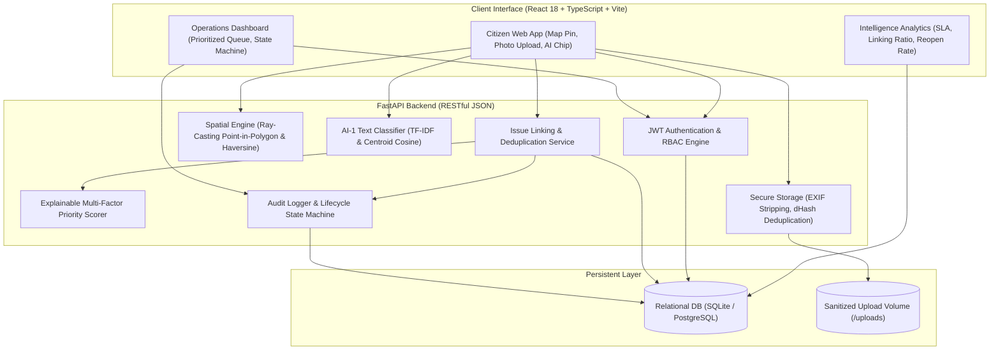

# System Architecture — Urban Infrastructure Intelligence

## Overview
This platform implements an **issue-centric civic intelligence system** for urban infrastructure maintenance in Bengaluru. It decouples raw citizen submissions (treated as **observations**) from tracked **issues** (real-world potholes, open trenches, garbage dumps), establishing an auditable lifecycle and explainable multi-factor prioritization.

## Architecture Diagram

## Key Technical Decisions
1. **Issue-Centric Spine:** Avoids ticket inflation by grouping spatial and semantic duplicates into a single ground truth issue record.
2. **Pure Python Spatial Verification:** Uses ray-casting Point-in-Polygon against official GeoJSON polygons for Koramangala, Indiranagar, and HSR Layout, ensuring zero dependency on complex native C GIS libraries while guaranteeing portability.
3. **Auditable Citizen Verification:** A municipal officer cannot unilaterally mark a defect closed; it transitions to `resolved_pending_verification`, requiring citizen sign-off (`closed_verified`) or dispute (`reopened`).
4. **Hardware Scoping:** ESP32 water-level sensor telemetry is reserved for Phase 3 (if time permits).
